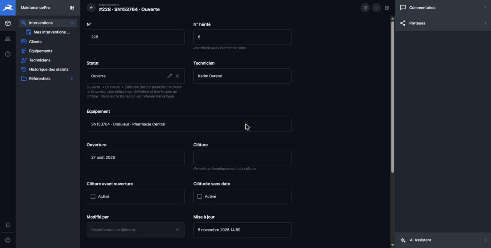
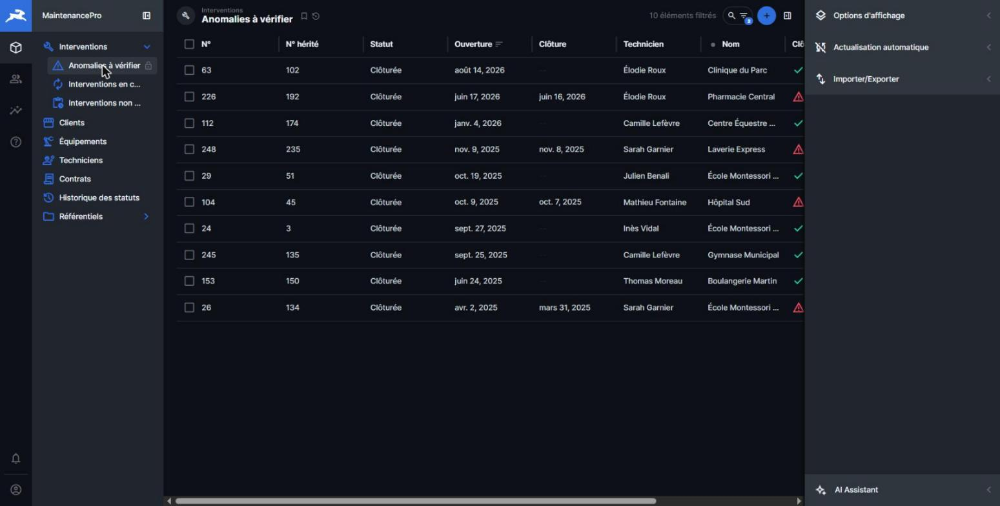
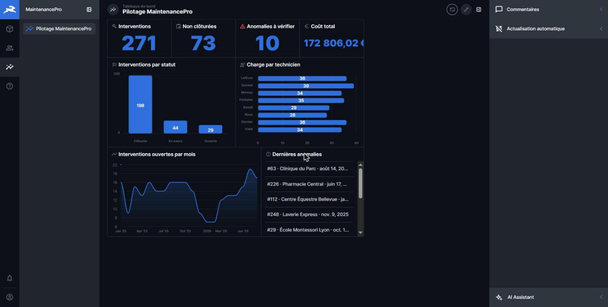

# Application de pilotage (no-code)

## Choix de l'outil : Directus 11.17.4

| Critère | Directus | Autres outils évalués |
|---|---|---|
| Se branche sur **notre** PostgreSQL existant | Oui : lit les tables, les clés étrangères et les colonnes calculées | NocoDB et Budibase oui ; Baserow passe par une synchronisation |
| Droits **par ligne** selon l'utilisateur connecté | Oui : filtres `$CURRENT_USER` dans les permissions | NocoDB Community : non (rôles par base seulement) |
| Droits **par champ** (le technicien ne modifie que le statut) | Oui, par action (lecture, création, modification) | Appsmith : rôles fins réservés à l'offre payante |
| Tout configurer **par API** (rejouable, versionné) | Oui : API REST complète (collections, champs, policies, rôles, signets, tableaux de bord) | Budibase : pas de création d'écrans par l'API ; NocoDB Community : MCP limité aux enregistrements |
| Gratuit | Oui. La v11 est sous licence BSL 1.1, gratuite sous 5 M$ de CA, sans clé ni limite de comptes. La v12 gratuite est limitée à 3 comptes. | — |

Sources : docs officielles Directus ([contrôle d'accès](https://directus.com/docs/guides/auth/access-control), [tarifs](https://directus.com/pricing)), [licence v11.17.4](https://raw.githubusercontent.com/directus/directus/v11.17.4/license), [MCP NocoDB](https://nocodb.com/docs/mcp).

## Lancer l'application

Tout est fait par `scripts/install.ps1` (ou `install.sh`) : voir le [guide d'installation](guide-installation.md). Étape par étape :

```powershell
./scripts/reset.ps1                       # base vide + seed
./scripts/run-sql.ps1 sql/migration.sql   # schéma + données
./scripts/setup-app.ps1                   # construit l'application (rejouable)
./scripts/verify-app.ps1                  # vérifie la séparation des droits
```

Les scripts Python tournent dans le conteneur `outils` : aucune installation de Python n'est nécessaire.

Adresse : http://localhost:8055

Comptes de démonstration (mots de passe dans `.env`, généré par l'installation) :

| Profil | Compte |
|---|---|
| Manager | `manager@example.com` |
| Technicien | `karim.durand@example.com`, `ines.vidal@example.com` |
| Administrateur | `admin@example.com` |

Les adresses e-mail des techniciens sont reportées dans `technicien.email` : c'est ce lien qui permet de filtrer leurs interventions.

## Captures

| Technicien : fiche d'intervention | Manager : anomalies à vérifier | Manager : tableau de bord |
|---|---|---|
|  |  |  |

## Interface technicien
- Ne voit **que ses interventions** (filtre `technicien_id.email = $CURRENT_USER.email`). La vue par défaut est triée par date, et un signet « Mes interventions à traiter » regroupe celles qui ne sont pas clôturées.
- Voit le client (nom, adresse, téléphone), l'équipement, les pièces et l'historique de chaque intervention.
- Ne peut modifier **que le statut**, dans l'ordre autorisé. La date de clôture se remplit toute seule.
- Ne voit ni les coûts, ni les contrats, ni les autres techniciens. Il ne supprime rien.

## Interface manager
- Voit toutes les interventions, avec technicien, client, coût et drapeaux d'anomalie.
- Signets : « Anomalies à vérifier », « Interventions non clôturées », « Interventions en cours ». Les filtres sont libres sur toutes les colonnes.
- Tableau de bord « Pilotage MaintenancePro » :
  - indicateurs : nombre d'interventions, non clôturées, anomalies, coût total ;
  - graphiques : répartition par statut, charge par technicien, ouvertures par mois ;
  - liste des dernières anomalies.
- Crée et affecte des interventions, gère clients, contrats, équipements et pièces. Il ne supprime rien et n'administre pas l'application.

## Matrice des droits

| Collection | Technicien | Manager |
|---|---|---|
| Interventions | lecture de **ses** lignes, sans le coût ; modification du **statut** seul | lecture totale, création, modification |
| Clients | lecture des clients de ses interventions, sans l'e-mail | lecture, création, modification |
| Équipements, lignes de pièces | lecture limitée à ses interventions | lecture, création, modification |
| Catalogue des pièces, types d'équipement | lecture | lecture, création, modification |
| Contrats | aucun accès | lecture, création, modification |
| Historique des statuts | lecture de ses interventions | lecture |
| Statuts, transitions | lecture | lecture |
| Tableau de bord | aucun accès | lecture |
| Suppression (toutes collections) | refusée | refusée |
| Table héritée | aucun accès | aucun accès |

## Trois niveaux de protection

1. **Directus** (policies) : filtres par ligne, champs autorisés par action, aucune suppression.
2. **PostgreSQL : droits.** Directus se connecte avec `directus_app`, membre de `mp_application`.
   - Il ne reçoit jamais `DELETE`, ni de droit sur la table héritée.
   - Il n'est **pas propriétaire** des tables, donc il ne peut pas modifier le schéma. La tentative de Directus de recréer une clé étrangère a d'ailleurs été refusée par la base (`must be owner of table intervention`).
3. **PostgreSQL : triggers.** Les règles métier s'appliquent à tous les clients, y compris l'admin Directus et pgAdmin.

## Logique côté base, et pourquoi l'outil ne peut pas la faire seul

| Logique | Où | Pourquoi dans la base |
|---|---|---|
| Cycle de vie des statuts (transitions autorisées, clôture définitive) | trigger `trg_intervention_avant_ecriture` + table `transition_statut` | La règle porte sur l'**ancienne et la nouvelle valeur**. Les validations Directus ne voient que la nouvelle. En base, elle s'applique aussi aux écritures faites hors de l'appli. |
| Date de clôture posée automatiquement à la clôture | même trigger | La valeur est garantie même si le client ne l'envoie pas. |
| Historique des statuts infalsifiable | trigger `SECURITY DEFINER` | L'application lit l'historique mais n'a **aucun droit d'écriture** dessus : seul le trigger y écrit. |
| Drapeaux d'anomalie | colonnes `GENERATED ALWAYS AS … STORED` | Calculés par PostgreSQL à chaque écriture, ils ne peuvent être ni oubliés ni modifiés. Directus les affiche en lecture seule et les utilise dans les filtres et les indicateurs. |
| Interdiction de supprimer | absence du droit `DELETE` | « Aucune intervention ne doit être supprimée » vaut aussi en dehors de l'appli. |

## Limites connues
- **Messages d'erreur.** Directus ne transmet jamais le détail d'une erreur de base aux utilisateurs non administrateurs : un technicien voit « erreur inattendue » sur une transition interdite.
  - La règle reste appliquée. `verify.py` vérifie que le statut n'a pas changé, et que le message exact remonte côté admin.
  - Pour compenser, la note du champ Statut rappelle les transitions autorisées.
- **Métadonnées des relations.** Celles des relations « un vers plusieurs » sont écrites par [`directus/relations.sql`](../directus/relations.sql), parce que l'API Directus voudrait recréer nos clés étrangères. Seule la table interne de Directus est modifiée.
- **Relations pour les non-admins.** Directus ne montre une relation à un non-admin que s'il peut lire **ses deux côtés**. Le technicien a donc accès en lecture aux champs inverses (`equipement.interventions`, `client.equipements`), qui ne renvoient que des lignes déjà autorisées par son filtre.
- **Filtres GraphQL.** Le tableau de bord passe par GraphQL, qui exige la forme imbriquée sur une relation : `statut_code: {code: {_neq: "cloturee"}}`.
- **Tables système.** Celles de Directus (`directus_*`) sont dans le schéma `public`. Elles appartiennent à `directus_app` et n'ont aucun lien avec les tables métier.

## Fichiers
- [`directus/setup.py`](../directus/setup.py) : construit l'application entière par l'API REST (rejouable).
- [`directus/relations.sql`](../directus/relations.sql) : métadonnées des relations.
- [`directus/verify.py`](../directus/verify.py) : contrôles automatiques de la séparation des droits.
- [`directus/schema-snapshot.yaml`](../directus/schema-snapshot.yaml) : export du modèle de données Directus (`directus schema snapshot`).
