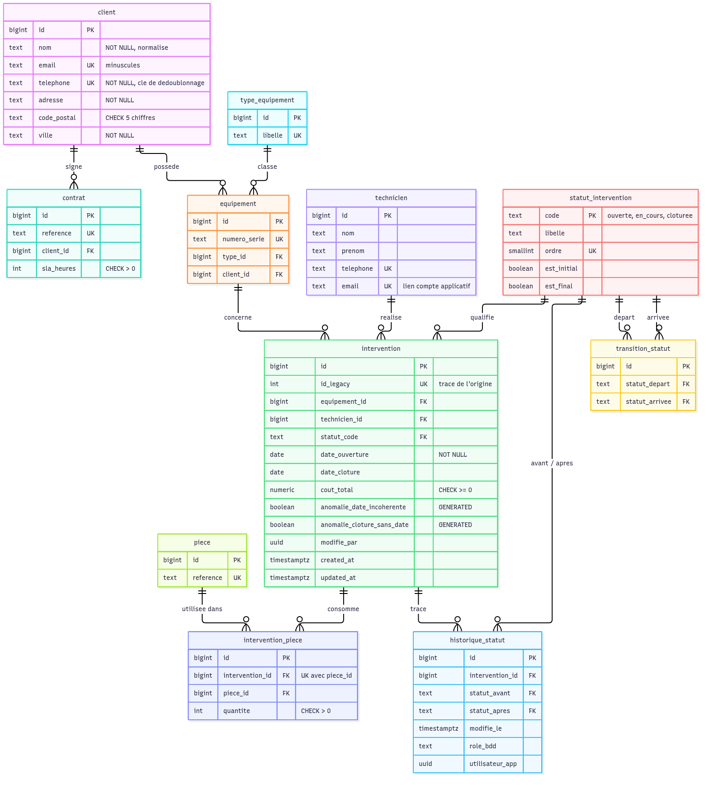

# Schéma normalisé

Source du diagramme : [`schema.mmd`](schema.mmd) (Mermaid). Le script qui crée ce schéma est [`sql/migration.sql`](../sql/migration.sql).

## Choix de conception

| Choix | Justification |
|---|---|
| **3NF** : une entité par table (client, contrat, technicien, équipement, pièce, intervention) | Supprime la redondance de l'audit (D10) : une adresse ne se modifie qu'à un seul endroit. |
| Le client d'une intervention se retrouve **via l'équipement** | Un équipement appartient à un seul client (A14). Stocker aussi `client_id` dans `intervention` créerait une dépendance transitive et un risque d'incohérence. |
| `contrat` séparé de `client` | Le SLA appartient au contrat, pas à l'intervention (D11, E01). Le schéma accepte plusieurs contrats par client sans modification. |
| `intervention_piece` (table de liaison) | Remplace le champ multivalué `pieces_utilisees` (1NF, D9). `quantite > 0` et `UNIQUE (intervention_id, piece_id)`. |
| `piece` sans prix | Les données héritées ne contiennent **aucun prix unitaire** : on ne l'invente pas. |
| Clés techniques `bigint GENERATED ALWAYS AS IDENTITY` + `UNIQUE` sur les clés naturelles (téléphone, référence de contrat, n° de série, référence de pièce) | La clé technique est stable. La clé naturelle empêche les doublons et sert de cible à `ON CONFLICT`, ce qui rend la migration rejouable. Une clé simple par table est aussi exigée par l'outil no-code (il ne gère pas les clés composées). |
| Statuts dans une **table de référence** et non un `ENUM` | Ajouter ou renommer un statut se fait par `INSERT` ou `UPDATE`, sans `ALTER TYPE`. Les transitions autorisées sont aussi des **données** (`transition_statut`). |
| `id_legacy` (`UNIQUE`, nullable) | Trace l'origine de chaque intervention migrée. `NULL` pour une intervention créée après la migration. |
| Types : `date`, `numeric(10,2)`, `integer`, `timestamptz`, `text` | Corrige D2, D3 et D4. `numeric` pour l'argent : calcul exact, sans arrondi flottant. |
| Index sur **toutes les clés étrangères** et sur `date_ouverture` | PostgreSQL n'indexe pas les clés étrangères automatiquement. Ces index couvrent les filtres de l'appli (par technicien et par période, par statut). |

## Anomalies : conservées et signalées

Deux colonnes **calculées par la base** (`GENERATED ALWAYS AS … STORED`) sur `intervention` :

| Colonne | Règle |
|---|---|
| `anomalie_date_incoherente` | `date_cloture < date_ouverture` |
| `anomalie_cloture_sans_date` | `statut_code = 'cloturee' AND date_cloture IS NULL` |

- Les 10 interventions concernées sont migrées **sans correction**.
- Le drapeau ne peut pas être oublié ni falsifié, puisque personne ne peut écrire dans ces colonnes. Il est recalculé si quelqu'un corrige la date explicitement.
- La contrainte `ck_intervention_dates_saisie` impose des dates cohérentes **aux nouvelles interventions** (`id_legacy IS NULL`) sans rejeter l'historique.
- La vue `v_anomalies` les liste avec le client, le technicien et le type d'anomalie.

## Règles métier appliquées par la base

Triggers sur `intervention` :

| Trigger | Rôle |
|---|---|
| `trg_intervention_avant_ecriture` | Refuse toute transition absente de `transition_statut`. Une intervention clôturée est définitive. Remplit automatiquement `date_cloture` à la clôture. Refuse une clôture antérieure à l'ouverture. Une nouvelle intervention commence au statut initial. `id_legacy` ne peut pas être modifié. |
| `trg_intervention_historique_*` | Écrit chaque changement de statut dans `historique_statut` (rôle de connexion et utilisateur applicatif). La fonction est `SECURITY DEFINER` : l'application lit l'historique mais ne peut pas l'écrire elle-même. |

Cycle de vie autorisé : `ouverte → en_cours → cloturee`, et `en_cours → ouverte` pour remettre une intervention en attente.

Ces règles s'appliquent **quel que soit le client** qui écrit (application no-code, pgAdmin, future API).

## Rôles et droits (moindre privilège)

| Rôle | Connexion | Droits |
|---|---|---|
| `mp_owner` | non | Propriétaire de tous les objets métier. Seule la migration crée ou modifie le schéma. |
| `mp_application` | non | `SELECT`, `INSERT`, `UPDATE` sur les tables métier. `SELECT` seul sur les statuts, les transitions et l'historique. **Jamais `DELETE`** : aucune intervention ne peut disparaître. Aucun droit sur `interventions_legacy`. |
| `mp_lecture` | non | `SELECT` sur les vues de reporting. |
| `directus_app` | oui | Compte de l'outil no-code, membre de `mp_application`. Il ne peut pas modifier la structure des tables métier. |

## Contrat d'interface

| Vue | Contenu |
|---|---|
| `v_export_interventions(id_legacy, date_ouverture, date_cloture, statut, cout_total, anomalie)` | Les interventions migrées. |
| `v_export_entites(entite, nb)` | `clients`, `techniciens`, `equipements`, `lignes_pieces` après nettoyage. |
